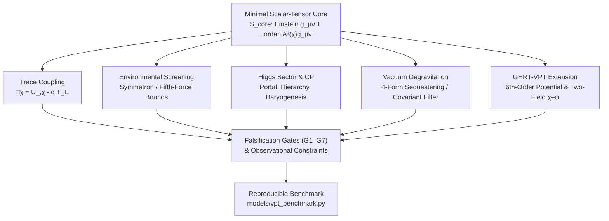

# Granular Higgs Recoil Theory (GHRT)

> [!NOTE]
> **Epistemic Status:** GHRT is an **exploratory, unvalidated physics research program**. Nothing in this repository constitutes a confirmed physical theory, a peer-reviewed result, or an engineering blueprint. All equations, toy benchmarks, and open tensions are documented transparently so failures are discovered early.

**Granular Higgs Recoil Theory (GHRT)** investigates whether the physical vacuum can be modeled as a dynamical scalar-tensor degree of freedom $\chi$ that responds to the trace of the matter stress-energy tensor $T = T^\mu{}_\mu$, connects to the Higgs sector, and admits environmental screening, vacuum-energy mechanisms, and an explicitly speculative extension called **GHRT-VPT** (Vacuum Phase Transitions).

---

## Program Architecture



---

## 1. The Central Idea & Mathematical Core

GHRT introduces a hypothetical canonical scalar field $\chi$, distinct from the observed $125\text{ GeV}$ Higgs excitation $h$. Matter couples universally (at the baseline level) to the Jordan-frame metric

$$
\widetilde g_{\mu\nu} = A^2(\chi)\,g_{\mu\nu},
$$

while gravity is formulated in the Einstein frame with signature $(-,+,+,+)$ and reduced Planck mass $M_{\rm Pl} = (8\pi G)^{-1/2}$:

$$
S_{\rm core} = \int d^4x\,\sqrt{-g}\left[\frac{M_{\rm Pl}^2}{2}R - \frac{1}{2}(\partial\chi)^2 - U(\chi)\right] + S_m\left[A^2(\chi)g_{\mu\nu},\psi\right].
$$

Varying with respect to $\chi$ gives the Einstein-frame scalar equation

$$
\Box\chi = U_{,\chi}(\chi) - \alpha(\chi)T_E, \qquad \alpha(\chi) \equiv \frac{d\ln A}{d\chi}, \qquad \beta(\chi) \equiv M_{\rm Pl}\,\alpha(\chi).
$$

For a perfect fluid, $T_E = -\rho_E + 3p_E$:
- **Nonrelativistic dust ($p_E \approx 0$):** $T_E = -\rho_E$, yielding an effective potential $U_{\rm eff}(\chi;\rho_*) = U(\chi) + \rho_*[A(\chi) - 1]$ at fixed conserved auxiliary density $\rho_* = \rho_E/A = A^3\widetilde\rho$.
- **Ideal radiation ($p_E = \rho_E/3$):** classical trace vanishes ($T_E = 0$), though quantum trace anomalies and Standard Model mass-threshold kicks $\Sigma(T)$ remain nonzero.
- **Relativistic massive gas:** $|T_E|/\rho_E = \gamma^{-2}$ for an isotropic monoenergetic population.

This provides a covariant restatement of GHRT's original “Slip-Stream” intuition without introducing a preferred rest frame or a literal vacuum lattice. It does **not** by itself imply drag, friction, energy loss, or a new interaction cross-section.

---

## 2. The GHRT-VPT Extension & Benchmark Audit

To study first-order vacuum transitions rather than continuous symmetron symmetry breaking, the exploratory **GHRT-VPT** extension introduces a sixth-order effective potential ($y = \chi/f$):

$$
U_{\rm eff}(y;\rho_*) = U_0 + E_*^4\left[a(\rho_*)\frac{y^2}{2} - \frac{y^4}{4} + \frac{y^6}{6}\right], \qquad a(\rho_*) = a_0 + \frac{\rho_* f^2}{M^2 E_*^4},
$$

and a two-field generalization $(\chi,\varphi)$ separating the cosmological sensor $\chi$ from a high-energy transition field $\varphi$ (see [docs/12-vpt-model-and-calculations.md](docs/12-vpt-model-and-calculations.md) and [docs/16-mathematical-audit-and-unification-architectures.md](docs/16-mathematical-audit-and-unification-architectures.md)).

### Verified Benchmark Numbers & Open Tensions

All algebraic derivations and numerical scales are independently verified in [models/vpt_benchmark.py](models/vpt_benchmark.py) and [docs/16-mathematical-audit-and-unification-architectures.md](docs/16-mathematical-audit-and-unification-architectures.md):

| Metric / Tension | Value (Toy Benchmark at $a=0.180$) | Scientific Implication |
| :--- | :--- | :--- |
| Dark-energy reference scale $E_*$ | $2.240365\text{ meV}$ | Calibrated to Planck 2018 $\Lambda$CDM ($H_0 = 67.4\text{ km/s/Mpc}$, $\Omega_\Lambda = 0.685$); **not** a GHRT prediction |
| Degenerate wall tension $\sigma_{\rm deg}$ | $\frac{9}{64\sqrt{3}}\,f E_*^2 \approx 0.08119\,f E_*^2$ | Exact analytical integral at $a = 3/16$ |
| Bounce action coeff. $B_{\rm TW}$ vs. exact $O(4)$ | $2.527 \times 10^5$ vs. $2.944 \times 10^5\,(f/E_*)^4$ | Thin-wall underestimates flat $O(4)$ action by $16.4\%$ ($-3.7\%$ in calibrated $f$); gravitational CDL bounce still required |
| Mass hierarchy $m_\chi / (\hbar H_\infty)$ | $4.36 \times 10^{30}$ | Single field cannot simultaneously slow-roll on Hubble scales and nucleate at $\text{meV}$ scales |
| Fifth-force coupling $\beta$ ($\Delta a = 0.01$) | $1.13 \times 10^{29}$ (at $M = 2.79\text{ meV}$) | Severe fifth-force tension unless heavily screened; at $M = M_{\rm Pl}$, $\Delta a \approx 1.31 \times 10^{-62}$ |
| Reheating energy deficit vs. BBN | $u_{\rm rad}(5.96\text{ MeV}) / u_\Lambda \approx 1.77 \times 10^{38}$ | Present dark energy ($T_{\Delta U} \approx 6.66\text{ K}$) cannot power a hot Big Bang; requires a high-energy sector |
| Worldline survival ($\varepsilon = 10^{-3}$) | $\tau \approx 4.18 \times 10^{12}\text{ yr}$ | Global false-vacuum volume can grow ($\varepsilon < 9/4\pi$) while any fixed worldline decays ($P(10^{14}\text{ yr}) \approx 4.18 \times 10^{-11}$) |

---

## 3. Structural Corrections & Unification Architectures

An independent audit ([docs/16-mathematical-audit-and-unification-architectures.md](docs/16-mathematical-audit-and-unification-architectures.md)) identified six structural corrections (`S1`–`S6`) needed in the baseline postulates and proposed four symmetry-driven coupling architectures:

1. **Scale-Invariant Higgs–Dilaton Unification:** Generates both $M_{\rm Pl}$ and the electroweak VEV $v$ from spontaneous scale-symmetry breaking, removing Higgs/conformal double-counting (`S1`), unifying Compton phase with $A(\chi)$ (`S6`), and protecting the scalar mass via Einstein-frame shift symmetry.
2. **Two-Scalar "Clock & Switch" Hybrid ($\chi$–$\varphi$):** Separates the ultralight cosmological sensor $\chi$ from a high-energy transition field $\varphi$, resolving the $10^{30}$ mass mismatch, the cosmic-void stability constraint (`S2`), and the $10^{38}$ BBN reheating deficit (`S3`).
3. **Covariant 4-Form Sequestering & Vacuum Cascade:** Replaces non-covariant spatial filters $G_{\rm eff}(\mathbf{k})$ (`S5`) with a ghost-free 4-form $F_{\mu\nu\rho\sigma}$ coupled to $\chi$.
4. **Derivative / Axial CP & Disformal Metric Couplings:** Activates spontaneous baryogenesis ($\mu_{\rm eff} = \dot\varphi/\Lambda_{\rm CP}$) inside moving bubble walls while vanishing statically today, and uses disformal couplings $\partial_\mu\chi\partial_\nu\chi$ to evade static $1/r^2$ fifth-force bounds.

---

## 4. Repository Map

### Core Theory & Formalism
- [docs/00-concept.md](docs/00-concept.md) — Conceptual motivation, provenance of ideas, and epistemic discipline.
- [docs/01-postulates.md](docs/01-postulates.md) — Candidate postulates `P1`–`P7` and their evidential status.
- [docs/02-mathematical-framework.md](docs/02-mathematical-framework.md) — Einstein/Jordan frames, scalar-tensor action, FLRW equations, and $O(4)$ Coleman–De Luccia system.
- [docs/03-higgs-vacuum-sector.md](docs/03-higgs-vacuum-sector.md) — Higgs portals, dimensional analysis, CP violation, and radiative stability.
- [docs/04-trace-coupling.md](docs/04-trace-coupling.md) — Conformal coupling to $T^\mu{}_\mu$ and relativistic/dust regimes.
- [docs/05-screening.md](docs/05-screening.md) — Symmetron screening benchmark and fifth-force constraints.
- [docs/06-vacuum-degravitation.md](docs/06-vacuum-degravitation.md) — The unsolved constant-vacuum degravitation problem.
- [docs/07-cosmology.md](docs/07-cosmology.md) — Cosmic acceleration, false-vacuum volume growth, and daughter regions.
- [docs/08-time-compton-phase.md](docs/08-time-compton-phase.md) — Proper time, Compton frequency, and phase modulation.
- [docs/09-observational-constraints.md](docs/09-observational-constraints.md) — Cosmological, gravitational, particle-physics, and reheating constraints.
- [docs/10-falsification-tests.md](docs/10-falsification-tests.md) — Logic gates `G1`–`G7` and model rejection criteria.

### GHRT-VPT, Audits & Roadmap
- [docs/12-vpt-model-and-calculations.md](docs/12-vpt-model-and-calculations.md) — Sixth-order VPT potential, thin-wall derivations, thermal budgets, and two-field architecture.
- [docs/13-intelligence-and-cosmic-continuity.md](docs/13-intelligence-and-cosmic-continuity.md) — Motivating AI cosmic-continuity thought experiment, Landauer/Gibbons–Hawking bounds, and causal-horizon limits.
- [docs/14-audit-and-corrections-2026-11-21.md](docs/14-audit-and-corrections-2026-11-21.md) — Critical audit (`C1`–`C6`, `E1`–`E6`, `O1`–`O6`).
- [docs/15-research-roadmap.md](docs/15-research-roadmap.md) — Sequenced Stages 0–6 with explicit acceptance criteria.
- [docs/16-mathematical-audit-and-unification-architectures.md](docs/16-mathematical-audit-and-unification-architectures.md) — Independent mathematical verification ($O(4)$ bounce check), six structural corrections (`S1`–`S6`), and four unification architectures.

### Benchmark, Literature & Provenance
- [models/vpt_benchmark.py](models/vpt_benchmark.py) — Reproducible Python standard-library benchmark and algebraic assertions.
- [papers/literature-review.md](papers/literature-review.md) — Primary literature references with DOIs/arXiv links.
- [archive/](archive/README.md) — Unedited historical source texts (preserved in original Spanish for provenance).
- [docs/11-manual-correcciones-v0.1.md](docs/11-manual-correcciones-v0.1.md) — Preserved correction manual (in Spanish) for the earlier v0.1 master document.
- `notebooks/` — Empty Jupyter scaffolds; not evidence of executed calculations.
- `manuscript/GHRT.tex` — Minimal LaTeX scaffold, **not** the source of any prior master PDF.
- [REPOSITORY_AUDIT.md](REPOSITORY_AUDIT.md) — Tracked-content and publication audit.

---

## 5. Quickstart & Reproduction

No external packages are required to run the algebraic benchmark:

```bash
python3 models/vpt_benchmark.py
```

This verifies the extrema, energy differences, calibrated toy scales, thermal limits, and relativistic kinematics of the sixth-order benchmark potential. It is an **algebraic consistency check**, not a gravitational Coleman–De Luccia solver or empirical validation.

### Epistemic Tagging Convention
All technical claims in the documentation are categorized using:
- `[LITERATURE]` — Established results from peer-reviewed physics literature.
- `[DERIVATION]` — Analytical consequences derived from explicit actions/conventions.
- `[BENCHMARK]` — Calibrated or toy numerical values for order-of-magnitude testing.
- `[GHRT HYPOTHESIS]` — Unproven theoretical proposals specific to GHRT / GHRT-VPT.
- `[SPECULATION]` — Long-term conceptual questions without an established physical mechanism.

---

## 6. Provenance & License

The earlier v0.1 correction manual (`docs/11-manual-correcciones-v0.1.md`) and `archive/` texts are preserved as *source history*; this repository does not claim to be a complete transcription of the author's external master PDFs. The explanatory YouTube videos referenced in `docs/13` ([video 1](https://www.youtube.com/watch?v=bpGum1z8MfA), [video 2](https://www.youtube.com/watch?v=oRBu7wYuOSo)) are narrative prompts only, **not primary physics references**.

**License:** No license has been selected. The repository's public visibility does not grant third-party permission to reuse or redistribute its contents; licensing and attribution terms remain to be decided by the project owner.
